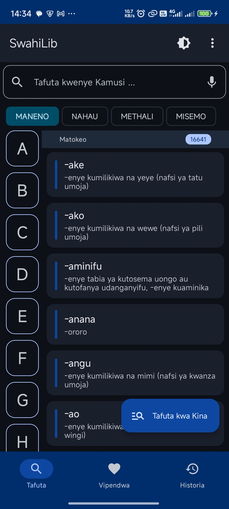
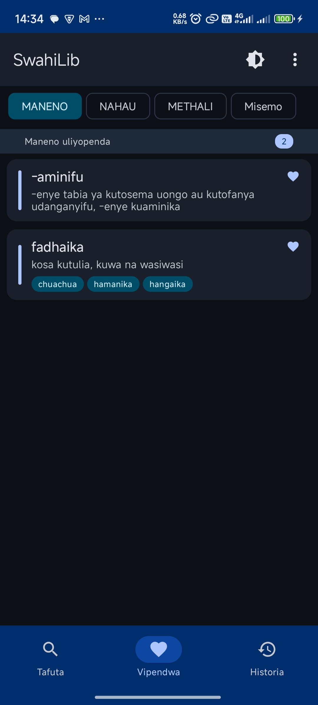
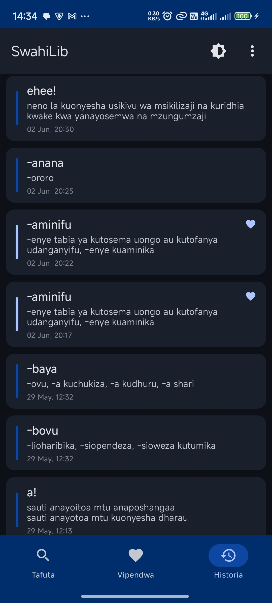
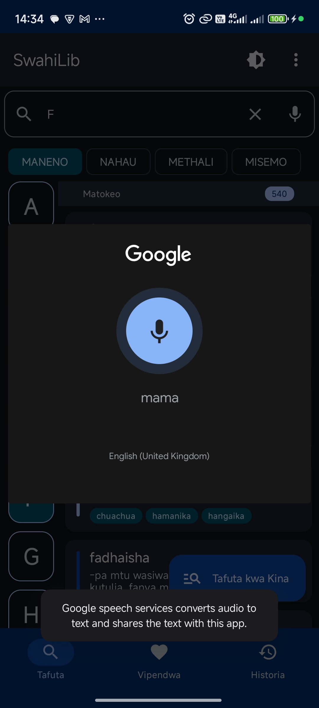

# SwahiLib - Kamusi ya Kiswahili

**SwahiLib** is a beautifully crafted Android app for exploring **Swahili words, idioms, sayings, and proverbs** — now grown into a full language-learning companion with word games, daily content, progress tracking, and social features, all with offline-first support and a clean UI.

This version is built using **Jetpack Compose**, **Room**, **Hilt**, **Retrofit/Ktor**, **Firebase**, and **Supabase**.

> 🔗 iOS Version Repo: [@SiroDaves/SwahiLib-iOS](https://github.com/SiroDaves/SwahiLib-iOS)

<a href='https://play.google.com/store/apps/details?id=com.swahilib'>
  
</a>

## ✨ Screenshots
<table>
    <tr>
        <td></td>
        <td></td>
        <td></td>
        <td></td>
    </tr>
</table>

## ✨ Features

* 🔍 **Search** for Swahili **words**, **idioms**, **sayings**, and **proverbs**, including advanced/filtered search
* 📘 **View details** by tapping on any result, including **synonyms** where available
* 💾 **Offline-first** support using a **Room** database
* 📅 **Daily content** — a fresh word/proverb of the day, also available as **home screen widgets** ("Neno la Siku" and "Neno na Methali ya Siku")
* 🎮 **Word games** to practice and reinforce learning:
  * Quiz
  * Crossword
  * Sudoku (Swahili edition)
  * Hangman
  * Spelling
  * Sentence Builder
  * Word Builder
* 📈 **Progress tracking** and **history** of what you've explored and played
* ❤️ **Likes/favorites** to bookmark words, idioms, sayings, and proverbs
* 👥 **Social features** and **authentication** via Google Sign-In (Credential Manager) and Firebase Auth
* 💝 **Support the app** via an in-app donation/billing flow
* 🆘 **Help** and **"How it works"** in-app guidance
* ⚙️ **Settings** for personalizing the experience
* 💉 **Dependency injection** powered by **Hilt**
* 🐞 **Crash & performance monitoring** via **Sentry**

## 🧰 Tech Stack

### UI & Architecture

* Jetpack Compose (Material 2 & Material 3, Navigation, LiveData, Previews)
* Multi-module architecture — a shared `core` layer plus one `feature` module per screen/capability
* Hilt for Dependency Injection
* Room for the local, offline-first database
* WorkManager (with Hilt integration) for background sync
* Kotlinx Serialization

### Networking & Backend

* Retrofit + OkHttp (with logging) and Ktor client for HTTP networking
* Gson converter for Retrofit
* Firebase Auth for authentication
* Supabase (Auth, Postgrest, Realtime) for backend data and social features
* Google Identity / Credential Manager for Google Sign-In

### Other

* Google Play Billing for in-app donations
* Sentry for crash reporting and performance monitoring
* Android home screen widgets ("word of the day" widgets)

## 🏗 Project Structure

The app is split into an `app` module plus reusable `core` modules and one `feature` module per capability:

**`core`**
`common` · `data` · `database` · `design_system` · `engagement` · `games` · `network` · `social` · `ui`

**`feature`**
`home` · `library` · `word` · `idiom` · `proverb` · `saying` · `advanced_search` · `daily_content` ·
`quiz` · `crossword` · `sudoku` · `hangman` · `spelling` · `sentence_builder` · `word_builder` ·
`progress` · `history` · `likes` · `social` · `auth` · `donation` · `settings` · `help` · `how_it_works`

## 🚀 Getting Started

### 1. Clone the Repository

```bash
git clone https://github.com/SiroDaves/SwahiLib-Android.git
cd SwahiLib-Android
```

### 2. Open in Android Studio

Open the project in the latest stable version of **Android Studio** (with support for `compileSdk`/`targetSdk` 37 — a recent stable release is recommended).

Requirements:
* JDK 11
* `minSdk` 26, `targetSdk`/`compileSdk` 37

### 3. Build the Project

The app uses Gradle version catalogs for dependencies. Android Studio should sync and resolve everything automatically. If not, run:

```bash
./gradlew clean build
```

Or use **Sync Project with Gradle Files** in the IDE.

### 4. Configuration

Some features require local configuration that isn't checked into the repo:
* `app/google-services.json` — Firebase project config
* `keystore/key.properties` — signing config for release builds
* `local.properties` — local secrets such as your Sentry auth token

### 5. Run the App

Connect a physical Android device or use an emulator, then click **Run** or press:

```
Shift + F10
```

## 📄 Notes

* The app syncs content from a Supabase/remote backend and stores it in Room for offline usage.
* Data updates are triggered automatically via ViewModel and WorkManager logic.
* All dependencies are managed using **libs.versions.toml** for cleaner and centralized version control.

## 📦 Main Libraries Used

| Category              | Library                                          |
| ---------------------- | ------------------------------------------------- |
| UI                     | Jetpack Compose (Material 2 & Material 3)          |
| DI                     | Hilt                                               |
| Database               | Room                                               |
| Networking              | Ktor, Retrofit, OkHttp, Gson                       |
| Serialization           | kotlinx.serialization.json                         |
| Backend / Auth          | Firebase Auth, Supabase (Auth, Postgrest, Realtime), Google Identity |
| Background Work        | WorkManager (+ Hilt)                               |
| Billing                 | Google Play Billing                                |
| Monitoring              | Sentry                                             |

## 🛠 License

This project is open-source and available under the [MIT License](LICENSE).